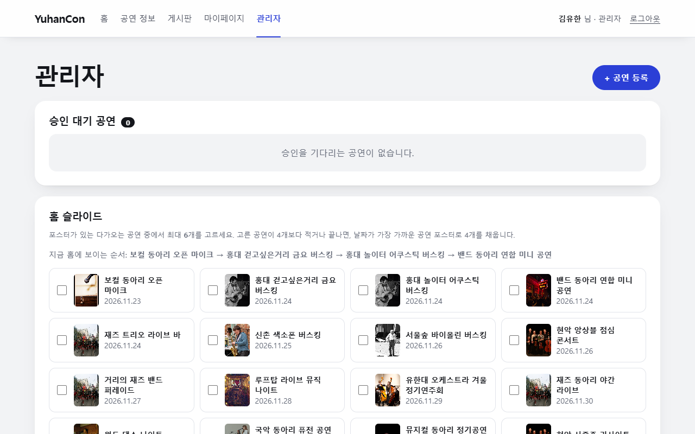

# YuhanCon

> 학교 공연부터 버스킹·콘서트까지, 가까운 무대를 찾고 예매하는 공연 플랫폼

공연을 찾고 좌석을 골라 예매하고, 같이 갈 사람은 게시판에서 구하는 웹 애플리케이션입니다.
Spring Boot 숙련을 위한 2인 팀 프로젝트로 시작해, 권한·승인·좌석 예매·보안까지 실제 서비스 수준으로 다듬었습니다.

---

## 목차

- [주요 기능](#주요-기능)
- [화면](#화면)
- [기술 스택](#기술-스택)
- [구조](#구조)
- [보안](#보안)
- [설치 및 실행](#설치-및-실행)
- [팀원 역할](#팀원-역할)

---

## 주요 기능

**회원·권한**
- 아이디(영문+숫자 6~12자) 기반 회원가입, 아이디 중복 확인
- 권한 3가지: 일반 사용자(예매), 공연 등록자(등록 + 예매), 관리자
- 로그인 상태 유지(14일), 로그인 5번 연속 실패 시 10분 잠금

**공연**
- 분류(콘서트·학교공연·버스킹·기타) 필터와 정렬(최신 등록순·오래된 등록순·좋아요 순)
- 공연 등록자가 올린 공연은 관리자 승인 후 공개
- 좌석 지정 공연(열마다 좌석 수 설정)과 자유석 공연
- 좋아요, 지난 공연 목록

**예매**
- 좌석표에서 직접 좌석 선택, 1인 최대 6석
- 한 공연에 예매 하나, 예매 수정·취소, 매진·지난 공연 처리
- 동시 예매에도 같은 좌석이 두 번 팔리지 않음(DB 유일 제약 + 행 잠금)

**홈**
- 포스터 풀스크린 슬라이드(관리자가 공연과 순서를 고름, 5초 자동 진행)
- 이번 주 무대(오늘부터 7일, 하루 2개 + 나머지 개수)
- 분류 칩으로 바꿔 보는 다가오는 공연

**게시판**
- 글 작성·수정·삭제, 좋아요, 조회수
- 댓글과 여러 단계 답글, 답글 접기/펼치기, 답글이 달린 댓글은 "삭제된 댓글"로 남김

**마이페이지·관리자**
- 티켓 모양 예매 내역, 좋아요한 공연, 최근 본 공연, 내가 등록한 공연, 내가 쓴 글
- 관리자: 승인 대기 공연 일괄 승인, 홈 슬라이드 선택·순서 변경, 모든 공연·글 관리

---

## 화면

### 홈


> 포스터 슬라이드 아래에 오늘부터 7일 동안의 공연을 보여 줍니다. 하루에 공연이 많으면 2개까지 보이고 나머지는 개수로 표시합니다.

### 공연

| 공연 목록 | 공연 상세(좌석 지정) | 공연 등록 |
|:---:|:---:|:---:|
|  |  |  |

### 예매

| 자유석 예매 | 좌석 선택 |
|:---:|:---:|
|  |  |

### 게시판

| 글쓰기 | 글 목록 | 글 상세(댓글·답글) |
|:---:|:---:|:---:|
|  |  |  |

### 마이페이지 · 관리자

| 마이페이지 | 관리자 |
|:---:|:---:|
|  |  |

> 화면의 공연 사진은 시연용으로 넣은 CC 라이선스 이미지(Openverse)입니다.

---

## 기술 스택

| 구분 | 기술 |
|------|------|
| Backend | Java 21, Spring Boot 3.5, Spring Security 6, Spring Data JPA (Hibernate) |
| DB | H2 (서버 모드) |
| Frontend | Thymeleaf, HTML / CSS / JavaScript (프레임워크 없이 CSS·JS 파일 하나씩) |
| Test | JUnit 5, MockMvc (메모리 DB로 기능·보안 테스트 18개) |
| Build | Maven (Maven Wrapper 포함) |

---

## 구조

```
com.yuhancon
├── controller   요청을 받아 서비스 하나를 부르고 화면/리다이렉트를 돌려준다
├── service      입력 검사, 권한 확인, 좌석 계산 같은 규칙
├── repository   Spring Data JPA
├── domain       엔티티 (Member, Concert, Reserve, ReservedSeat, Board, Comment, ...)
├── web          폼 DTO (엔티티를 폼에 직접 바인딩하지 않는다)
├── security     로그인 사용자, 보안 기록
└── config       보안 설정, 시작 데이터
```

---

## 보안

OWASP Top 10 기준으로 점검하고 고쳤습니다.

- 비밀번호 BCrypt, CSRF 토큰, 로그인 5회 실패 잠금
- 본인 확인을 화면과 서비스 양쪽에서(남의 글·공연·예매 수정 차단)
- 폼 DTO로 `id`·`role` 끼워 넣기 차단, 게시글은 글자로만 출력(XSS 방지)
- CSP(`script-src 'self'`, `frame-ancestors 'none'`), 업로드 파일 확장자 + 파일 앞부분(매직 바이트) 검사
- 보안 기록: 로그인 성공·실패·잠금, 권한 없는 접근, 관리자 작업을 `logs/security.log`에 남김
- 관리자 계정은 회원가입으로 만들 수 없고, 비밀번호는 소스에 적지 않고 환경변수로만 받음

---

## 설치 및 실행

Java 21이 필요합니다. 명령은 `YuhanCon/` 폴더에서 실행합니다(Windows PowerShell 기준).

**1. H2 DB 서버 켜기** (터미널 하나를 켜 둔다)

```powershell
java -cp "$env:USERPROFILE\.m2\repository\com\h2database\h2\2.3.232\h2-2.3.232.jar" org.h2.tools.Server -tcp -tcpPort 9092 -web -webPort 8082
```

처음이라 DB 파일이 없으면 한 번 만들어 줍니다.

```powershell
java -cp "$env:USERPROFILE\.m2\repository\com\h2database\h2\2.3.232\h2-2.3.232.jar" org.h2.tools.Shell -url jdbc:h2:~/yuhancon2 -user sa -sql "SELECT 1"
```

**2. 앱 실행** (새 터미널)

```powershell
cd YuhanCon
$env:YUHANCON_ADMIN_PASSWORD = Read-Host "관리자 비밀번호"   # 처음 실행할 때만
.\mvnw.cmd spring-boot:run
```

- 관리자가 없으면 시작할 때 `admin01` 계정을 만듭니다. 비밀번호는 위에서 입력한 값(없으면 무작위로 만들어 시작 로그에 한 번 표시).
- `http://localhost:8080` 접속, DB 콘솔은 `http://localhost:8082` (`jdbc:h2:tcp://localhost/~/yuhancon2`, `sa`, 비밀번호 없음)

**테스트**

```powershell
.\mvnw.cmd test -Dtest=YuhanConFlowTest   # H2 서버 없이 메모리 DB로 실행
```

**환경변수**

| 이름 | 용도 |
|------|------|
| `YUHANCON_ADMIN_PASSWORD` | 첫 관리자(`admin01`) 비밀번호 |
| `YUHANCON_REMEMBER_KEY` | "로그인 상태 유지" 쿠키 서명 키 (없으면 재시작 때마다 풀림) |
| `YUHANCON_DEMO_PASSWORD` | 공연이 없을 때 시연 데이터를 넣고 시연 계정 비밀번호로 사용 |

---

## 팀원 역할

| 역할 | 담당 내용 |
|------|----------|
| 김수길 | 구조 설계, 회원가입 및 로그인, 게시판 관련 기능, 마이페이지 |
| 김원정 | 메인화면 슬라이드, 공연 미리보기 기능, 공연정보 관련 기능, 테스트 |
