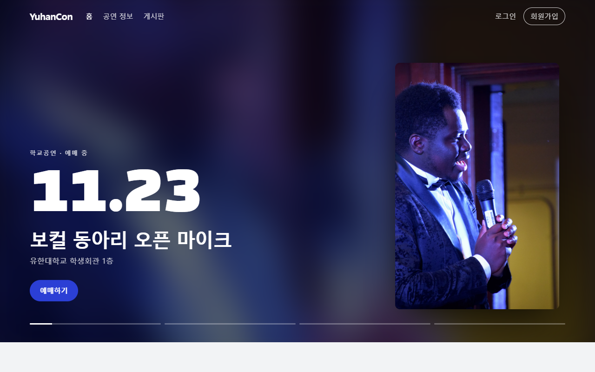
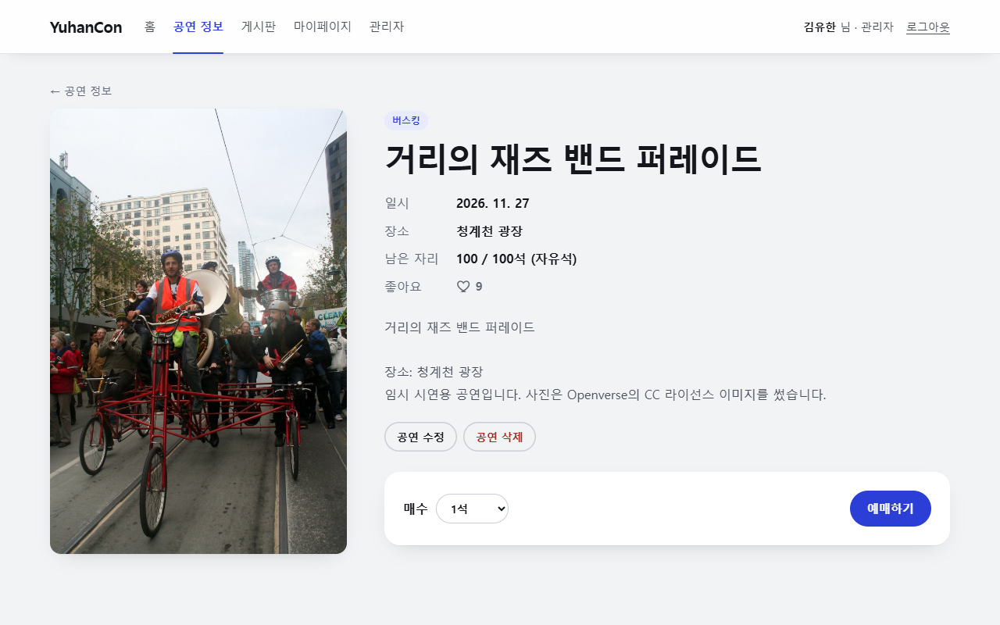
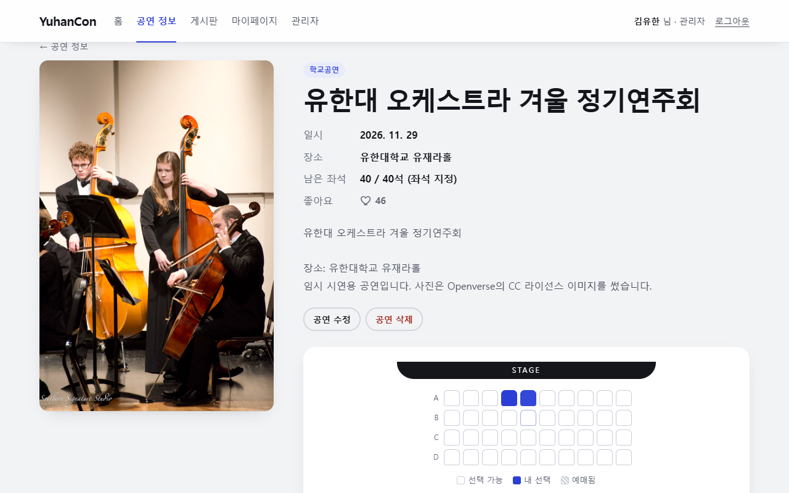
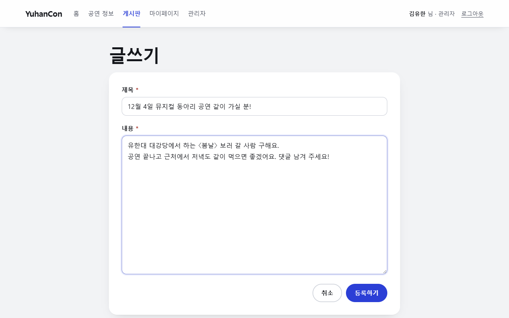
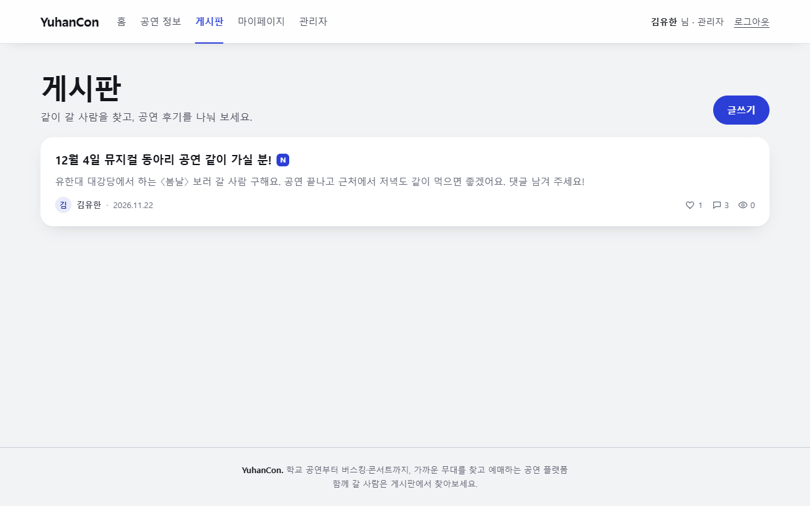
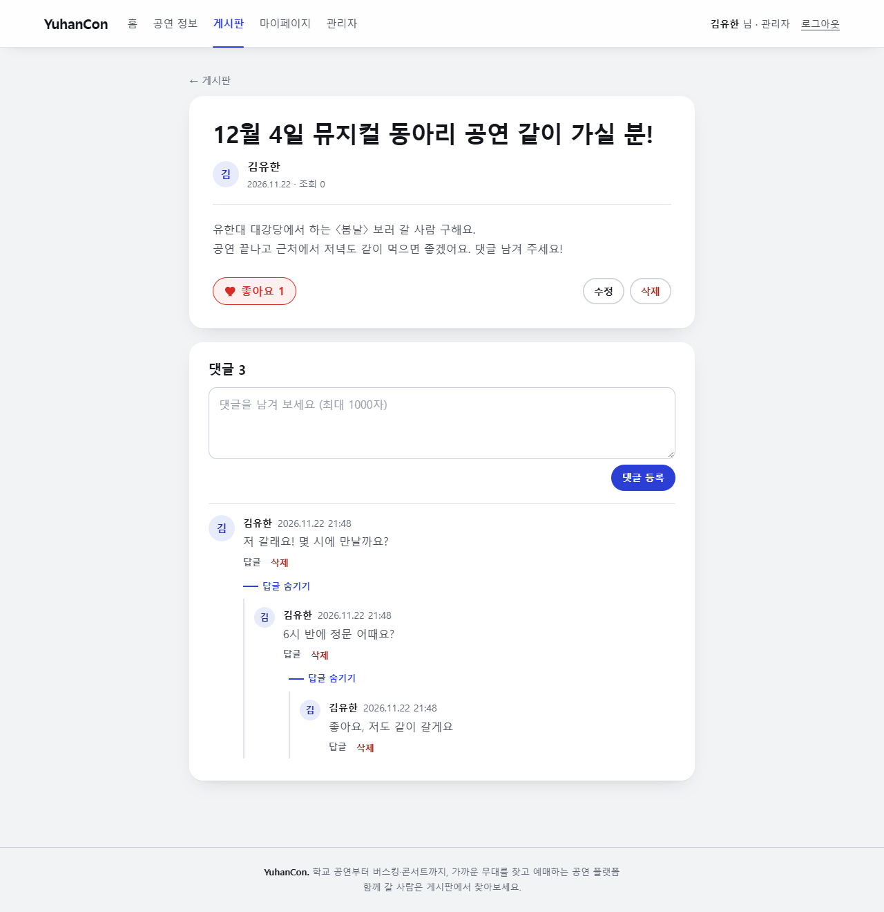

# 🎸 YuhanCon

> 학교 공연부터 버스킹·콘서트까지, 가까운 무대를 찾고 예매하는 공연 플랫폼

| 항목 | 내용 |
|------|------|
| 기간 | 2025.06.12 ~ 2025.06.22 (팀 개발) · 2026.11 (개인 리뉴얼) |
| 인원 | 2명 (김수길, 김원정) → 리뉴얼 김원정 |
| 기술 | Java 21, Spring Boot 3.5, Spring Security 6, Spring Data JPA, H2, Thymeleaf, JavaScript, HTML/CSS, JUnit 5 |
| 테스트 | 기능·보안 테스트 18개 (MockMvc, 메모리 DB) |

---

## 📖 내용

- 공연을 찾고, 좌석을 골라 예매하고, 같이 갈 사람을 게시판에서 구하는 웹 서비스입니다.
- 2025년 6월 Spring Boot 숙련을 위한 2인 팀 프로젝트로 시작했습니다.
- 2026년 11월 코드를 다시 읽으며 보안 점검을 하고, 구조·기능·디자인을 서비스 수준으로 다시 만들었습니다.
- 권한을 일반 사용자 · 공연 등록자 · 관리자로 나누고, 공연 등록자가 올린 공연은 관리자 승인 후 공개됩니다.
- 좌석표에서 자리를 고르는 좌석 지정 공연과 매수만 고르는 자유석 공연을 지원하며, 동시에 예매해도 같은 좌석이 두 번 팔리지 않습니다.

---

## 🖼️ 화면

### 홈




> 포스터 풀스크린 슬라이드(관리자가 공연과 순서를 고름)와 오늘부터 7일간의 공연. 하루에 공연이 많으면 2개까지 보이고 나머지는 "외 N개"로 표시합니다.

### 공연 · 예매

| 공연 목록 | 공연 상세(좌석 지정) | 공연 등록 |
|:---:|:---:|:---:|
|  |  |  |

| 자유석 예매 | 좌석 선택 |
|:---:|:---:|
|  |  |

### 게시판

| 글쓰기 | 글 목록 | 글 상세(댓글·답글) |
|:---:|:---:|:---:|
|  |  |  |

### 마이페이지 · 관리자

| 마이페이지 | 관리자 |
|:---:|:---:|
|  |  |

> 화면의 공연 사진은 시연용으로 넣은 CC 라이선스 이미지(Openverse)입니다.

---

## 🙋 역할

### 2025.06 팀 프로젝트

| 이름 | 담당 |
|------|------|
| 김수길 | 구조 설계, 회원가입·로그인(Spring Security), 게시판, 마이페이지(예약 내역·최근 본 공연·회원 수정), 예약 취소 |
| 김원정 | 프로젝트 생성, 메인 화면(슬라이드·상단바), 공연 등록·목록·상세·수정·삭제, 포스터 업로드, 예매, 공연 화면 CSS, DB 설계서, 전체 테스트 |

### 2026.11 개인 리뉴얼 (김원정)

- **구조**: 컨트롤러에 몰려 있던 규칙을 서비스 계층(회원·공연·예매·게시판)으로 옮기고, 폼은 DTO로만 받아 요청에 `id`·`role`을 끼워 넣는 공격을 막았습니다.
- **회원·권한**: 아이디를 기본키로 바꾸고, 권한 3단계, 공연 승인 흐름, 로그인 5회 실패 시 10분 잠금을 만들었습니다.
- **예매**: 좌석 지정 예매를 새로 만들었습니다. 고른 좌석은 (공연, 좌석) 유일 제약이 걸린 행으로 저장하고, 남은 좌석은 조건부 UPDATE로 줄이며, 예매 수정·취소는 행을 잠그고 읽습니다.
- **게시판**: 좋아요, 여러 단계 답글(접기/펼치기), 카드형 목록을 넣었습니다.
- **보안**: OWASP Top 10 기준으로 점검했습니다. BCrypt, CSRF, CSP, 업로드 파일 매직 바이트 검사, 보안 기록(로그인·권한 거부·관리자 작업)을 넣었습니다.
- **디자인**: 포스터 풀스크린 홈, 입장권 모양 공연 카드, 티켓형 예매 내역, 모바일 대응으로 화면을 새로 만들었습니다.
- **테스트**: 실행 확인용 1개뿐이던 테스트를 기능·보안 테스트 18개로 늘렸습니다.

---

## ✨ 주요 기능

| 구분 | 기능 |
|------|------|
| 회원 | 아이디 중복 확인, 권한 선택 가입(일반/공연 등록자), 로그인 상태 유지, 로그인 실패 잠금 |
| 공연 | 분류 필터·정렬, 좌석 지정/자유석, 좋아요, 승인 후 공개, 지난 공연 |
| 예매 | 좌석 직접 선택(1인 최대 6석), 한 공연 한 예매, 수정·취소, 매진·지난 공연 처리 |
| 게시판 | 글 CRUD, 좋아요, 조회수, 여러 단계 답글, 삭제된 댓글 표시 |
| 마이페이지 | 티켓형 예매 내역, 좋아요한 공연, 최근 본 공연, 내가 등록한 공연·쓴 글 |
| 관리자 | 승인 대기 공연 일괄 승인, 홈 슬라이드 선택·순서 변경, 모든 공연·글 관리 |

---

## 🔧 트러블슈팅

### 1. 업로드한 포스터가 바로 보이지 않던 문제 (2025)

- **문제**: 공연을 등록한 직후 상세 화면에 이미지가 보이지 않고, 서버를 다시 켜야 나타났습니다.
- **원인**: 이미지를 `static` 폴더에 저장했는데, Spring Boot는 빌드 결과물 안의 정적 파일을 보여 주므로 실행 중에 추가된 파일을 찾지 못했습니다.
- **해결**: 저장 위치를 프로젝트 밖 `uploaded-images` 폴더로 옮기고 `WebMvcConfigurer`의 리소스 핸들러로 `/uploaded-images/**`에 연결했습니다.

### 2. 동시에 예매하면 남은 좌석이 틀어지던 문제 (2026 리뉴얼)

- **문제**: 남은 좌석을 "읽고 → 빼고 → 저장"하는 사이에 다른 예매가 들어오면 좌석 수가 맞지 않았고, 입력칸에서만 막은 좌석 수는 요청을 직접 보내면 0 이하도 저장됐습니다.
- **해결**: 좌석 수 검증을 서버로 옮기고, 남은 좌석은 `available_seats >= n` 조건이 붙은 UPDATE 한 문장으로 줄였습니다. 고른 좌석은 (공연, 좌석) 유일 제약으로 같은 좌석이 두 번 저장되지 않게 했습니다.

### 3. 공연을 수정하면 남은 좌석·좋아요 수가 옛 값으로 돌아가던 문제 (2026 리뉴얼)

- **문제**: 공연을 고치는 사이에 다른 사람이 예매하거나 좋아요를 누르면, 저장 후 그 숫자가 수정 화면을 연 시점의 값으로 덮였습니다.
- **원인**: JPA가 바뀌지 않은 컬럼까지 모두 UPDATE했고, 예매·좋아요는 별도 UPDATE로 숫자를 바꿔 두 쓰기가 겹쳤습니다.
- **해결**: `@DynamicUpdate`로 바뀐 컬럼만 쓰게 하고, 좋아요 수는 `updatable = false`로 막아 전용 UPDATE로만 바꾸게 했습니다. 공연 수정은 `PESSIMISTIC_WRITE`로 행을 잠그고 읽습니다.

### 4. 홈 슬라이드를 다시 저장하면 선택이 빠지던 문제 (2026 리뉴얼)

- **원인**: 일괄 UPDATE로 순서를 지운 뒤 영속성 컨텍스트에 남은 옛 엔티티를 다시 저장해 값이 덮였습니다.
- **해결**: `@Modifying(flushAutomatically = true, clearAutomatically = true)`로 실행 전후에 영속성 컨텍스트를 비웠습니다.

---

## 🔒 보안

- 비밀번호 BCrypt, CSRF 토큰, 로그인 5회 실패 시 10분 잠금
- 본인 확인을 화면과 서비스 양쪽에서(남의 글·공연·예매 수정 차단)
- 폼 DTO로 `id`·`role` 끼워 넣기 차단, 게시글은 글자로만 출력(XSS 방지)
- CSP(`script-src 'self'`, `frame-ancestors 'none'`), 업로드 확장자 + 매직 바이트 검사
- 로그인 성공·실패·잠금, 권한 없는 접근, 관리자 작업을 보안 기록으로 남김
- 관리자 계정은 회원가입으로 만들 수 없고, 비밀번호 같은 비밀값은 저장소에 두지 않고 실행할 때 환경변수로만 받음

---

## 💭 회고

- 코드를 다시 읽으며 화면에서만 막고 서버에서는 막지 않은 곳(좌석 수, 등록자 확인)과 동시에 요청이 들어오면 틀어지는 곳(남은 좌석)을 찾았습니다. "동작한다"와 "안전하다"는 다르다는 것을 배웠습니다.
- 테스트가 1개뿐일 때는 고칠 때마다 불안했는데, 규칙을 서비스로 옮기고 테스트를 붙인 뒤에는 큰 구조 변경도 자신 있게 할 수 있었습니다.

---

<details>
<summary><b>⚙️ 실행 방법</b></summary>

Java 21이 필요합니다. 명령은 `YuhanCon/` 폴더에서 실행합니다(Windows PowerShell 기준).

**1. H2 DB 서버 켜기** (터미널 하나를 켜 둔다)

```powershell
java -cp "$env:USERPROFILE\.m2\repository\com\h2database\h2\2.3.232\h2-2.3.232.jar" org.h2.tools.Server -tcp -tcpPort 9092 -web -webPort 8082
```

DB 파일이 없으면 한 번 만들어 줍니다.

```powershell
java -cp "$env:USERPROFILE\.m2\repository\com\h2database\h2\2.3.232\h2-2.3.232.jar" org.h2.tools.Shell -url jdbc:h2:~/yuhancon2 -user sa -sql "SELECT 1"
```

**2. 앱 실행** (새 터미널)

```powershell
$env:YUHANCON_ADMIN_PASSWORD = Read-Host "관리자 비밀번호"   # 처음 실행할 때만
.\mvnw.cmd spring-boot:run
```

관리자가 없으면 시작할 때 `admin01` 계정을 만듭니다. 비밀번호는 위에서 입력한 값이며, 입력하지 않으면 무작위로 만들어 시작 로그에 한 번 보여 줍니다. 접속 주소는 `http://localhost:8080`입니다.

**테스트**

```powershell
.\mvnw.cmd test -Dtest=YuhanConFlowTest   # H2 서버 없이 메모리 DB로 실행
```

**설정할 수 있는 환경변수** (값은 저장소에 없고, 실행하는 사람이 정합니다)

| 이름 | 용도 |
|------|------|
| `YUHANCON_ADMIN_PASSWORD` | 첫 관리자 비밀번호 |
| `YUHANCON_REMEMBER_KEY` | "로그인 상태 유지" 쿠키 서명 키 |
| `YUHANCON_DEMO_PASSWORD` | 시연 데이터를 넣을 때 시연 계정 비밀번호 |

</details>
