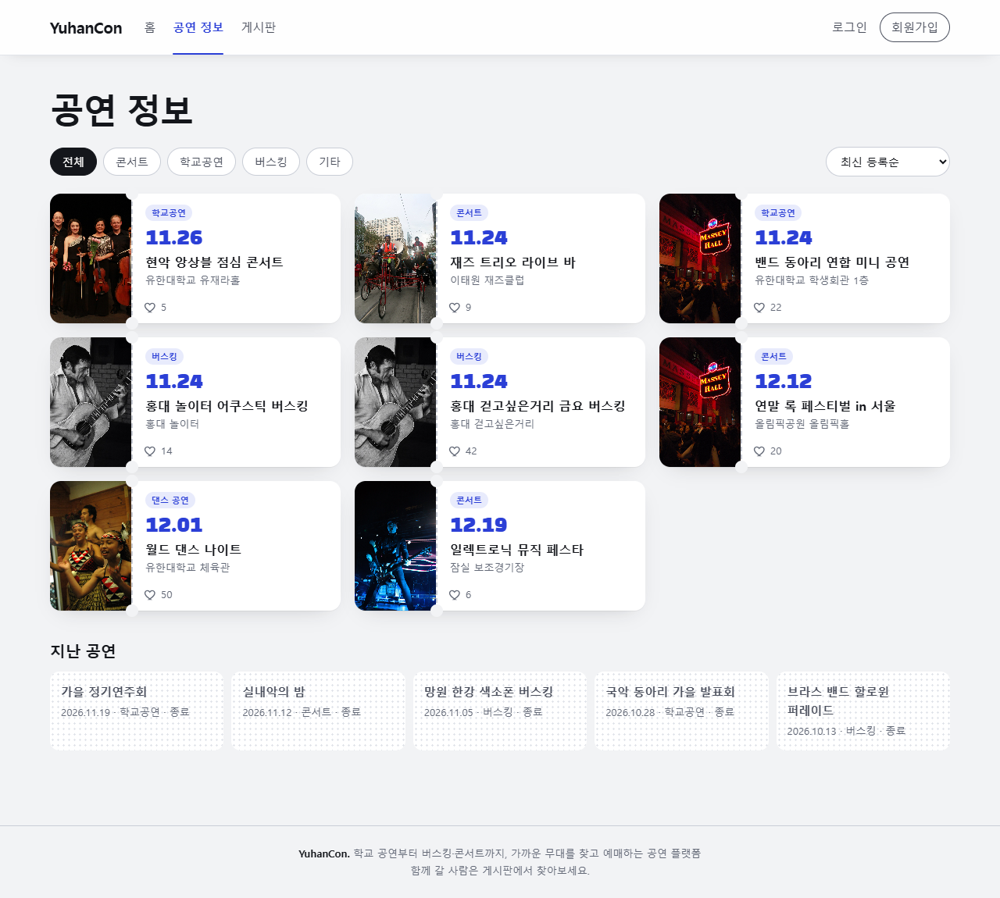
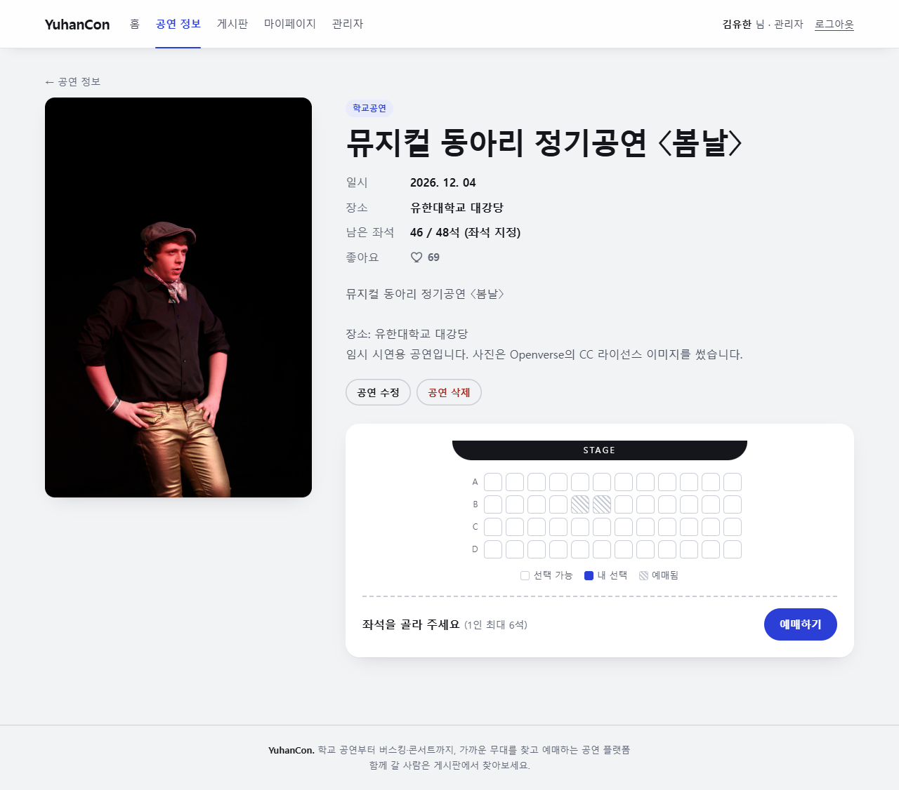
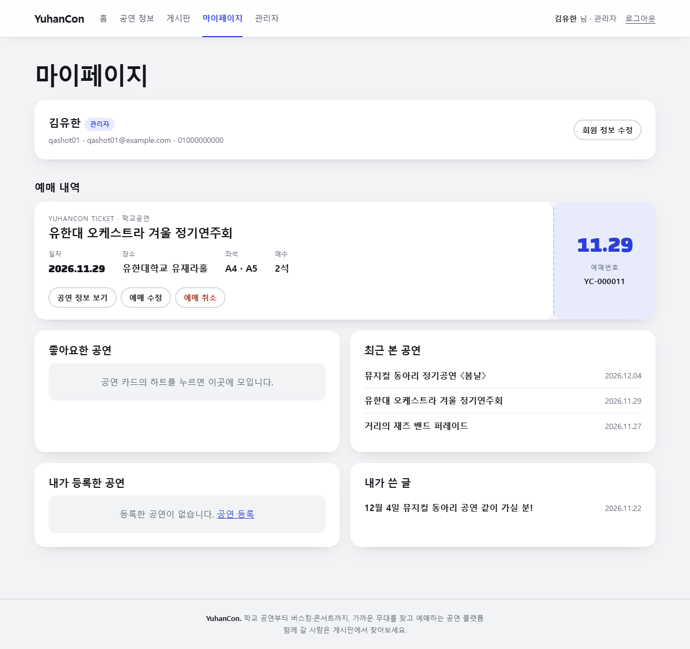
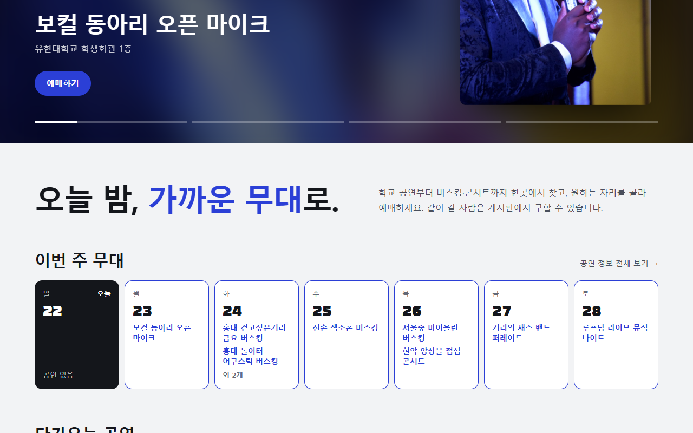
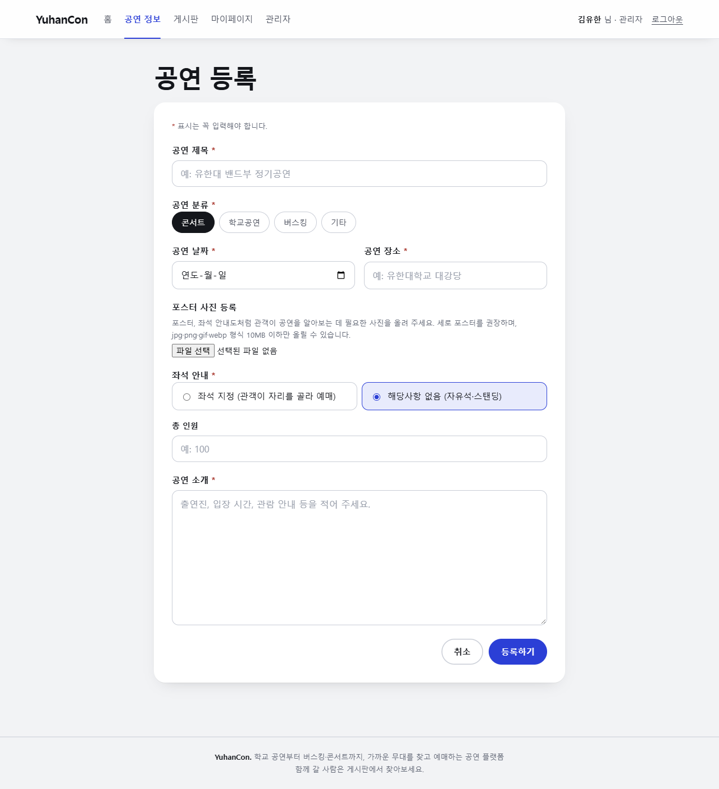

# YuhanCon

학교 공연부터 버스킹·콘서트까지, 가까운 무대를 찾고 예매하는 공연 플랫폼입니다.
공연을 찾고, 좌석을 골라 예매하고, 같이 갈 사람은 게시판에서 구할 수 있습니다.


## 주요 기능

- **회원**: 아이디 중복 확인, 일반 사용자/공연 등록자 가입, 로그인 상태 유지, 로그인 5회 실패 시 10분 잠금
- **공연**: 분류 필터(콘서트·학교공연·버스킹·기타)와 정렬, 좋아요, 지난 공연, 공연 등록자가 올린 공연은 관리자 승인 후 공개
- **예매**: 좌석표에서 직접 선택(좌석 지정) 또는 매수 선택(자유석), 1인 최대 6석, 예매 수정·취소
- **홈**: 포스터 슬라이드, 이번 주 무대, 분류별 다가오는 공연
- **게시판**: 글 작성·수정·삭제, 좋아요, 댓글과 여러 단계 답글
- **마이페이지**: 예매 내역, 좋아요한 공연, 최근 본 공연, 내가 등록한 공연·쓴 글
- **관리자**: 공연 일괄 승인, 홈 슬라이드 선택·순서 변경, 모든 공연·글 관리

## 스크린샷

| 공연 목록 | 공연 상세 | 좌석 선택 |
|:---:|:---:|:---:|
|  |  |  |

| 게시판 | 게시글·답글 | 마이페이지 |
|:---:|:---:|:---:|
|  |  |  |

| 이번 주 무대 | 공연 등록 | 관리자 |
|:---:|:---:|:---:|
|  |  |  |

> 화면의 공연 사진은 시연용 CC 라이선스 이미지(Openverse)입니다.

## 기술 스택

| 구분 | 기술 |
|------|------|
| Backend | Java 21, Spring Boot 3.5, Spring Security 6, Spring Data JPA (Hibernate) |
| Database | H2 (서버 모드) |
| Frontend | Thymeleaf, HTML, CSS, JavaScript |
| Test | JUnit 5, MockMvc |
| Build | Maven (Wrapper 포함) |

## 프로젝트 구조

```
YuhanCon/src/main/java/com/yuhancon
├── controller   요청 처리, 화면/리다이렉트 반환
├── service      입력 검사, 권한 확인, 좌석 계산 등 비즈니스 규칙
├── repository   Spring Data JPA 리포지토리
├── domain       엔티티 (Member, Concert, Reserve, ReservedSeat, Board, Comment ...)
├── web          폼 DTO
├── security     로그인 사용자, 보안 로그
└── config       보안 설정, 초기 데이터
```

## 시작하기

### 요구 사항

- Java 21
- H2 Database 2.3 (Maven이 받아 둔 jar 사용)

### 1. H2 서버 실행

```powershell
java -cp "$env:USERPROFILE\.m2\repository\com\h2database\h2\2.3.232\h2-2.3.232.jar" org.h2.tools.Server -tcp -tcpPort 9092 -web -webPort 8082
```

처음 실행해서 DB 파일이 없으면 한 번 만들어 줍니다.

```powershell
java -cp "$env:USERPROFILE\.m2\repository\com\h2database\h2\2.3.232\h2-2.3.232.jar" org.h2.tools.Shell -url jdbc:h2:~/yuhancon2 -user sa -sql "SELECT 1"
```

### 2. 애플리케이션 실행

```powershell
cd YuhanCon
.\mvnw.cmd spring-boot:run
```

`http://localhost:8080`에서 확인할 수 있습니다. 관리자 계정이 없으면 시작할 때 `admin01`이 만들어집니다.

### 환경변수

비밀값은 저장소에 두지 않고 실행할 때 환경변수로 받습니다.

| 이름 | 설명 |
|------|------|
| `YUHANCON_ADMIN_PASSWORD` | 첫 관리자(`admin01`) 비밀번호. 없으면 무작위로 만들어 시작 로그에 표시 |
| `YUHANCON_REMEMBER_KEY` | 로그인 상태 유지 쿠키 서명 키. 없으면 재시작할 때마다 풀림 |
| `YUHANCON_DEMO_PASSWORD` | 공연이 없을 때 시연 데이터를 넣고 시연 계정 비밀번호로 사용 |

### 테스트

```powershell
.\mvnw.cmd test -Dtest=YuhanConFlowTest
```

H2 서버 없이 메모리 DB로 기능·보안 테스트 18개를 실행합니다.

## 팀원

| 이름 | 담당 |
|------|------|
| 김수길 | 구조 설계, 회원가입·로그인, 게시판, 마이페이지, 예약 취소 |
| 김원정 | 메인 화면, 공연 등록·조회·수정·삭제, 포스터 업로드, 예매, DB 설계, 테스트 · 2026.11 리뉴얼(구조 개편, 권한·승인, 좌석 예매, 게시판 답글·좋아요, 보안, 디자인) |
